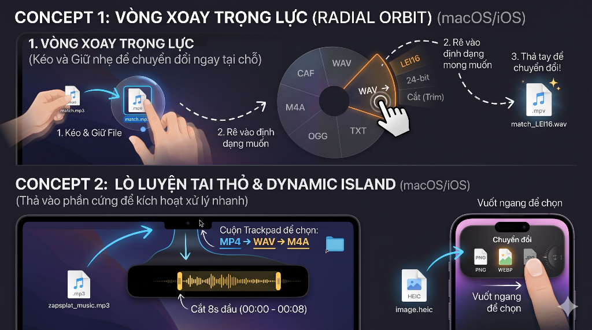

# DropLab 🧪✨

> **Next-Gen Drag & Drop File Converter for macOS & iOS**  
> Trợ lý kéo & thả chuyển đổi định dạng và xử lý file tức thì, tối ưu trải nghiệm tương tác tự nhiên trên macOS và iOS.

---

## 📸 Thiết Kế & Trải Nghiệm (Core Concepts)

---

### 🌀 Concept 1: Vòng Xoay Trọng Lực (Radial Orbit)
*Kéo và giữ nhẹ để chuyển đổi ngay tại chỗ (In-place Quick Convert).*

1. **Kéo & Giữ File:** Nhấn giữ và kéo nhẹ file bất kỳ từ Finder / Files.
2. **Rê vào định dạng mong muốn:** Một vòng xoay menu (Radial Orbit) xuất hiện ngay tại vị trí con trỏ chuột/ngón tay, hiển thị các định dạng phù hợp nhất (WAV, CAF, M4A, OGG, TXT...). Có thể rê sâu vào các tuỳ chọn nâng cao (LEI16, 24-bit, Cắt / Trim...).
3. **Thả tay để chuyển đổi:** Thả tay ra, file mới được xử lý và xuất ngay tại chỗ trong nháy mắt.

---

### 🏝️ Concept 2: Lò Luyện Tai Thỏ & Dynamic Island (Hardware Drop Zone)
*Tận dụng phần cứng tai thỏ (MacBook Notch) & Dynamic Island (iPhone) làm trạm xử lý siêu tốc.*

- **macOS (Notch Drop Zone):**
  - Kéo file và thả vào khu vực Tai thỏ (Camera Notch).
  - Giao diện mở rộng cho phép cuộn Trackpad để chuyển định dạng (`MP4` → `WAV` → `M4A`...).
  - Tích hợp công cụ waveform xử lý nhanh (ví dụ: cắt nhanh đoạn đầu `00:00 - 00:08`).
- **iOS (Dynamic Island Drop Zone):**
  - Kéo file và thả vào Dynamic Island.
  - Vuốt ngang để duyệt nhanh các định dạng đích (`PNG`, `WEBP`, `JPG`...).
  - Thả tay để chuyển đổi và lưu hoặc chia sẻ ngay lập tức.

---

## 🚀 Tính Năng Chính (Planned Features)

- [x] **Zero-Window Friction:** Không cần mở cửa sổ ứng dụng rườm rà, mọi thao tác diễn ra ngay trong luồng công việc kéo thả tự nhiên.
- [ ] **Hỗ trợ đa định dạng mạnh mẽ:**
  - **Audio:** MP3, WAV, M4A, FLAC, OGG, CAF, AAC...
  - **Image:** HEIC, PNG, JPG, WEBP, SVG, TIFF, PDF...
  - **Video:** MP4, MOV, MKV, GIF, WebM...
  - **Document / Data:** TXT, CSV, JSON...
- [ ] **Tối ưu phần cứng Apple Silicon & Neural Engine:** Xử lý local, nhanh chóng và bảo mật 100% dữ liệu của người dùng.
- [ ] **Tích hợp sâu hệ điều hành:** Hỗ trợ macOS Menu Bar, Notch Overlay, Quick Look, Finder Extension và iOS Drag & Drop + Dynamic Island Activity.

---

## 🛠️ Công Nghệ Dự Kiến

- **Language:** Swift 6.0+
- **Platforms:** macOS 14.0+ / iOS 17.0+
- **Frameworks:** SwiftUI, AppKit/UIKit, AVFoundation, CoreImage, UniformTypeIdentifiers, ActivityKit

---

## 📄 License

Dự án phát triển bởi tổ chức **fury-fish**. Giấy phép mã nguồn mở MIT License (hoặc theo quy định của tổ chức).
