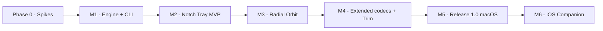

# 🗺️ OrbitDrop — Revised Roadmap / Lộ trình đã rà soát

> Bản này thay cho roadmap 4 milestone ban đầu trong `README.md`.
> Mục tiêu: **ra được MVP macOS dùng thật sớm nhất**, xử lý các rủi ro kỹ thuật lớn trước khi làm UI đẹp.

---

## 1. Review kết quả — Các vấn đề của plan cũ

| # | Vấn đề trong plan cũ | Mức độ | Lý do | Cách sửa |
|---|---|---|---|---|
| 1 | **iOS: kéo file thả vào Dynamic Island** | 🔴 Không khả thi | Live Activity / Dynamic Island chỉ hiển thị, **không nhận drop**. App iOS cũng không được vẽ đè lên app khác (Files, Photos). | iOS dùng **Share/Action Extension** + **App Intents (Shortcuts)** + drop zone *bên trong app*. Dynamic Island chỉ dùng để **hiện tiến trình** convert. |
| 2 | **iOS: Radial Orbit "kéo & giữ" khi đang ở app khác** | 🔴 Không khả thi | Không có global gesture/overlay trên iOS. | Radial Orbit trên iOS chỉ hoạt động **trong app** (iPad: drag từ Files ở Split View vào app). |
| 3 | **"100% native"** cho MP3/OGG/WebP/WebM/MKV/AVIF/EPS | 🔴 Sai | AVFoundation/AudioToolbox **không encode MP3**, không hỗ trợ OGG/Vorbis, WebM, MKV. ImageIO **đọc** được WebP nhưng **không ghi**. macOS mới đã bỏ render EPS/PostScript. | Chia 2 tầng: **Native core** (mặc định) + **Extended codecs** (`libwebp`, `LAME`, `libvorbis/opus`, hoặc `ffmpeg` LGPL, link động). Ghi rõ trong ma trận định dạng. |
| 4 | **Thả vào Notch rồi cuộn Trackpad 2 ngón để chọn định dạng** | 🟠 Khó dùng | Đang giữ click để kéo + cuộn 2 ngón cùng lúc gần như không làm được trên trackpad. | **Thả trước → tray giữ file → chọn bằng scroll / click / phím mũi tên → Enter**. |
| 5 | **Xuất file "ngay cạnh file gốc"** | 🟠 Rủi ro phân phối | App Sandbox (Mac App Store) chỉ cấp quyền cho file được thả, **không cấp quyền ghi vào thư mục cha**. | Giai đoạn đầu phân phối **Developer ID + Notarization** (không sandbox). Nếu lên App Store sau: xin quyền thư mục 1 lần + security-scoped bookmark, fallback `~/Downloads/OrbitDrop`. |
| 6 | **Làm cả 2 concept song song ngay từ M1–M2** | 🟠 Scope quá lớn | Hai cơ chế overlay khác nhau, nhân đôi chi phí UI/QA trước khi có converter chạy được. | MVP chỉ làm **Notch Tray** (drop target cố định, dễ nhất). Radial Orbit ở milestone sau. |
| 7 | **Notch chỉ có trên MacBook có tai thỏ** | 🟡 Thiếu | Mac mini/Studio, màn hình ngoài, MacBook Air Intel không có notch. | Fallback: **viên thuốc ẩn ở top-center** của màn hình đang chứa con trỏ. |
| 8 | **Phát hiện "global drag + hold 0.4s"** chưa được kiểm chứng | 🟡 Rủi ro | Cần theo dõi `NSPasteboard(name: .drag)` + global mouse monitor, phải không cản trở drag gốc và không gây giật. | Đưa vào **Phase 0 spike** trước khi cam kết UX Radial. |
| 9 | **Converter đặt ở M3, sau UI** | 🟡 Thứ tự sai | UI không có engine phía sau thì không demo/test được. | Làm **Conversion Engine + CLI** trước, UI gọi vào engine. |
| 10 | **Ma trận định dạng quá rộng** (EPUB, DOCX↔PDF, SVG→SwiftUI Shape, Whisper) | 🟡 Scope creep | Mỗi mục là một dự án con. | Chuyển sang **Backlog / Later**. |
| 11 | Thiếu phần **kiểm thử, hiệu năng, phân phối** | 🟡 Thiếu | Không có tiêu chí "Done". | Thêm Definition of Done cho mỗi milestone. |
| 12 | Tên không thống nhất: repo `DropLab` vs README `OrbitDrop (NotchAlchemy)` | 🟡 | Gây nhầm khi tạo bundle id, landing page. | Cần chốt 1 tên trước M1. |

---

## 2. Lộ trình mới

### Phase 0 — Technical Spikes (≈ 1 tuần)
Mục tiêu: trả lời "làm được không" trước khi viết code thật.
- [ ] Spike A: Phát hiện drag toàn cục (`NSPasteboard(name: .drag)` changeCount + `NSEvent.addGlobalMonitorForEvents(.leftMouseDragged)`), đo độ trễ và xác định hold 0.4s.
- [ ] Spike B: `NSPanel` non-activating ở vị trí notch (`NSScreen.safeAreaInsets`, `auxiliaryTopLeftArea`), nhận drop, không cướp focus app đang dùng.
- [ ] Spike C: Convert `mp3 → wav LEI16` và trim bằng `AVAssetReader/Writer`; `heic → png/jpg` bằng `ImageIO`.
- [ ] Spike D: Ghi file ra thư mục gốc khi chạy **không sandbox** + notarize thử.

**Done khi:** có báo cáo ngắn từng spike (OK / không OK / workaround).

### M1 — Conversion Engine + CLI (≈ 2 tuần)
- [ ] Swift Package `OrbitDropCore`: `Converter` protocol, registry theo `UTType` → danh sách đích hợp lệ.
- [ ] Converter native:
  - Audio: `wav`, `aiff`, `caf`, `m4a (AAC/ALAC)` + preset `LEI16`, `24-bit`, `Mono`, `Trim`.
  - Image: `heic`, `png`, `jpg`, `tiff`, `gif` + `Scale`, `Quality`, `Remove Alpha`; `png → icns`.
  - Data: `json ⟷ plist`, `minify/prettify`.
- [ ] CLI `orbitdrop convert in.mp3 --to wav --preset lei16` (thay thế trực tiếp `afconvert`/`ffmpeg` trong workflow hiện tại).
- [ ] Đặt tên file đầu ra an toàn (không ghi đè: `match_LEI16.wav`, `match_LEI16 2.wav`).

**Done khi:** unit test cho mỗi cặp định dạng với file mẫu; convert ảnh 12MP < 300 ms, audio 3 phút < 1 s trên M1.

### M2 — Notch Tray MVP (macOS) (≈ 2–3 tuần)
- [ ] App menu bar (`LSUIElement`), không có Dock icon.
- [ ] Vùng drop ở notch; fallback viên thuốc top-center cho máy không notch / màn hình ngoài.
- [ ] Luồng: **thả file → tray mở → chọn định dạng (scroll / click / ← → / Enter) → xuất cạnh file gốc**.
- [ ] Hỗ trợ thả **nhiều file** cùng lúc (batch), hiển thị tiến trình + Undo (xoá file vừa tạo).
- [ ] Settings: thư mục xuất, preset mặc định, bật/tắt từng concept, launch at login (`SMAppService`).

**Done khi:** dùng hằng ngày được cho workflow `mp3 → wav LEI16` và `heic → png` mà không mở cửa sổ nào.

### M3 — Radial Orbit (macOS) (≈ 2–3 tuần)
- [ ] Phát hiện drag + hold 0.4s (từ Spike A), hiện pie menu ngay dưới con trỏ.
- [ ] Vòng trong: định dạng đích theo `UTType`; vòng ngoài: preset (`LEI16`, `24-bit`, `Trim`...).
- [ ] Thả lên lát → convert; thả ra ngoài / nhấn `Esc` → huỷ, drag gốc vẫn hoạt động bình thường.
- [ ] Phím tắt thay thế: chọn file trong Finder + hotkey → mở Radial tại con trỏ.

**Done khi:** không làm hỏng drag & drop thông thường giữa các app (test với Finder, Safari, Xcode, Slack).

### M4 — Extended Codecs + Waveform Trim (≈ 2–3 tuần)
- [ ] Gói codec mở rộng (tách module, link động, ghi license): `mp3` encode (LAME), `webp` encode (libwebp), `ogg/opus`, `webm`.
- [ ] Waveform trimmer trong tray (tay cầm vàng, preview audio, `00:00 - 00:08`).
- [ ] Video: `mov ⟷ mp4`, `H.264/HEVC/ProRes`, trích audio, `→ gif`.

**Done khi:** tất cả định dạng trong ma trận "Phase M4" chạy được, license bên thứ ba có trong About.

### M5 — Release 1.0 macOS (≈ 1–2 tuần)
- [ ] Notarization, DMG, auto-update (Sparkle), crash report.
- [ ] Onboarding xin quyền (nếu cần), landing page + GIF demo.

### M6 — iOS / iPadOS Companion (sau 1.0)
- [ ] **Share/Action Extension**: "Convert with OrbitDrop" từ Files/Photos.
- [ ] **App Intents** để dùng trong Shortcuts.
- [ ] Drop zone + Radial Orbit **trong app** (đặc biệt hữu ích trên iPad Split View).
- [ ] Live Activity / Dynamic Island hiển thị **tiến trình** convert (không nhận drop).

---

## 3. Backlog / Later
- Speech-to-text `audio → txt/srt` (Speech framework hoặc whisper.cpp).
- OCR `image → txt` (Vision).
- `md ⟷ html ⟷ pdf`, DOCX, EPUB, merge/split/compress PDF.
- SVG → raster / SVG → SwiftUI `Shape`.
- Sprite sheet, `.appiconset` generator.
- Finder Quick Action / Services menu.

## 4. Câu hỏi cần chốt
1. Tên chính thức: `DropLab`, `OrbitDrop` hay `NotchAlchemy`?
2. Phân phối: Developer ID (khuyến nghị cho MVP) hay Mac App Store ngay từ đầu?
3. Có chấp nhận đóng gói thư viện bên thứ ba (LAME, libwebp, ffmpeg-LGPL) không?
