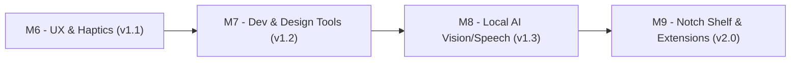

# 🗺️ DropLab — Roadmap & Phase 2 Plan

> **Trạng thái hiện tại:** 🎉 Đã hoàn thành toàn bộ lộ trình **Phase 1 — macOS v1.0.0** (`Phase 0`, `M1`, `M2`, `M3`, `M4`, `M5`) và bản vá quyền truy cập file thực tế (`109451c`).
> **Bước tiếp theo:** **Phase 2 (M6 ➔ M9)** — Tinh chỉnh UX thực chiến, công cụ cho Developer/Designer, và AI cục bộ trên Apple Silicon (`Vision` / `Speech`).

---

## 0. Quyết định cốt lõi (Đã chốt)

| # | Hạng mục | Quyết định |
|---|---|---|
| D1 | Tên sản phẩm | **DropLab** (Swift package `DropLabCore`, CLI `droplab`, App `DropLab.app`) |
| D2 | Phân phối | **Developer ID + Notarization**, không sandbox (để ghi file trực tiếp cạnh file gốc) |
| D3 | Codec bên thứ ba | **Đồng ý** đóng gói/liên kết LAME (`mp3`), libwebp (`webp`), FFmpeg LGPL (`ogg`, `flac`, `webm`), kèm license trong About |
| D4 | Nền tảng ưu tiên | **macOS là chính**, iPhone/iPad là phụ (chỉ làm sau khi bản Mac đã hoàn chỉnh) |
| D5 | Ưu tiên giao diện | **Vòng Xoay Trọng Lực (Radial Orbit — Concept 1)** là chủ lực, kết hợp **Lò Luyện Tai Thỏ (Notch Tray — Concept 2)** |

---

## 1. Phase 1 — Nền tảng macOS 1.0.0 (✅ Đã hoàn thành)

- [x] **Phase 0 — Technical Spikes:** Kiểm chứng `NSPasteboard(name: .drag)` 60 Hz, `NSPanel` non-activating + `NSDraggingDestination`, pipeline `AVAssetReader/Writer` & `ImageIO`.
- [x] **M1 — `DropLabCore` Engine + CLI `droplab`:**
  - Nhận diện `UTType`, `ConversionRegistry`, `SafeOutputNaming` (chống ghi đè), `ConversionHistory` (Undo 1 chạm).
  - Native Audio (`wav`, `caf`, `aiff`, `m4a` + `LEI16`, `24-bit`, `Mono`, `Trim 8s`), Image (`png`, `jpg`, `heic`, `tiff`, `icns`, `pdf`, `svg`), Video (`mp4`, `mov`, `Mute Audio`), Data (`json ⟷ plist`, `csv ⟷ tsv`).
- [x] **M2 — Radial Orbit MVP (Concept 1):**
  - Kéo & giữ yên chuột `0.4s` bung Vòng Xoay 2 tầng (Vòng trong: Định dạng đích, Vòng ngoài: Sub-Orbit Presets).
  - Thả chuột để convert ngay cạnh file gốc, Toast thông báo kèm nút mở Finder & Hoàn tác.
- [x] **M3 — Notch Tray + Inline Waveform Trimmer (Concept 2):**
  - Tự hiện viên thuốc đón file ở Notch khi bắt đầu kéo; thả file để mở khay điều khiển, cuộn Trackpad 2 ngón / phím `←` `→`, chỉnh 2 tay cầm vàng cắt Waveform & nghe thử (`Space`).
- [x] **M4 — Extended Codecs + Video/PDF Multi-tool:**
  - Tích hợp `mp3` (LAME), `webp` (`cwebp`), `ogg`, `flac`, `webm` (FFmpeg), `Video ➔ Animated GIF` (native `ImageIO`), gộp & tách trang PDF (`PDFKit`).
- [x] **M5 — Release 1.0 macOS Polish & File Access Fix:**
  - Đóng gói `DropLab.app` v1.0.0 kèm `AppIcon.icns`, `Launch at Login` (`SMAppService`), `About & Licenses`, mở khóa Security-Scoped / File-Reference URLs & bộ giải mã ảnh 4 tầng (`ImageIO` ➔ `CoreImage` ➔ `NSImage`).

---

## 2. Phase 2 — Lộ trình Tiếp theo (v1.1 ➔ v2.0)

### 🎯 M6 — Tinh chỉnh UX Vòng Xoay từ thực tế sử dụng + Haptics (v1.1)
*Giải quyết các điểm UX phát hiện khi kéo file thật trên Finder:*
- [ ] **Chống che khuất chữ Sub-Orbit bởi Thumbnail kéo của Finder:**
  - Khi đang kéo file trong Finder, macOS vẽ thumbnail + tên file ngay dưới con trỏ, dễ đè lên chữ của lát cắt Sub-Orbit (như `Scale 2x`).
  - **Giải pháp:** Hiển thị **Tên Định dạng + Preset đang chọn thật to ngay tại Tâm Vòng Xoay (Center Hub)** (ví dụ: tâm vòng xoay chuyển từ `.jpg` sang **`PNG • Scale 2x`**) kèm **Badge nổi phía trên con trỏ 48pt** để mắt người dùng luôn nhìn thấy rõ 100% dù thumbnail Finder to đến đâu.
- [ ] **Phản hồi xúc giác Trackpad (Haptic Feedback):**
  - Gọi `NSHapticFeedbackManager.defaultPerformer.perform(.alignment)` mỗi khi con trỏ lướt qua các lát cắt trong Vòng Xoay hoặc khi cuộn Trackpad chuyển định dạng trên Notch Tray.
- [ ] **Phím tắt toàn cục cấp hệ thống (Global Hotkey `⌥Space`):**
  - Đăng ký phím tắt toàn cục (`Carbon RegisterEventHotKey`) để khi đang chọn file trong Finder, chỉ cần bấm `⌥Space` là Vòng Xoay bung ngay tại con trỏ chuột mà không cần kéo.
- [ ] **Cải tiến hiển thị Toast & Progress cho file nặng:**
  - Hiển thị vòng xoay tiến trình (loading spinner) ngay tại vị trí thả khi xử lý video/audio dài.

### 🛠️ M7 — Công cụ Chuyên sâu cho Developer & Designer (v1.2)
- [ ] **Xcode `.appiconset` Generator:**
  - Kéo 1 ảnh gốc (`1024x1024.png`) ➔ chọn `ICNS -> .appiconset` ➔ xuất trọn bộ thư mục `AppIcon.appiconset` (đầy đủ mọi kích thước macOS/iOS + `Contents.json` chuẩn Xcode).
- [ ] **Nén PDF thông minh (`Compress PDF`):**
  - Nén dung lượng file PDF nặng (tái nén ảnh nhúng trong PDF bằng Quartz / ImageIO) giảm 50–80% dung lượng.
- [ ] **SVG ➔ SwiftUI `Shape` Code:**
  - Kéo file vector `.svg` ➔ sinh ra file `.swift` chứa `struct CustomShape: Shape` (hoặc copy thẳng code SwiftUI vào Clipboard).
- [ ] **SpriteSheet Generator:**
  - Kéo nhiều ảnh frame `.png` ➔ ghép thành 1 tấm `spritesheet.png` + file metadata `.json`.

### 🧠 M8 — On-Device Apple Silicon AI (v1.3 — 100% Offline & Miễn phí)
*Tận dụng sẵn Neural Engine thông qua framework `Vision` và `Speech` có sẵn trên macOS 14+:*
- [ ] **Tách nền ảnh 1 chạm (`PNG -> Remove BG`):**
  - Dùng `VNGenerateForegroundInstanceMaskRequest` (`Vision` framework) để tách nền chủ thể ra khỏi ảnh `.jpg`/`.png`/`.heic` và xuất ra `.png` nền trong suốt ngay tại chỗ.
- [ ] **OCR Trích xuất văn bản (`Image / PDF -> .txt / .md`):**
  - Dùng `VNRecognizeTextRequest` đọc chữ từ ảnh chụp màn hình hoặc PDF scan ra file `.txt` / `.md` (và tự copy vào Clipboard).
- [ ] **Audio / Video ➔ Phụ đề `.srt` & `.txt`:**
  - Dùng `SFSpeechRecognizer` (hoặc `whisper.cpp` nếu có) để chép lời file ghi âm/video thành phụ đề `.srt`.

### 🏝️ M9 — Khay Kéo-Ra ở Tai Thỏ (Notch Output Shelf) & Tiện ích Mở rộng (v2.0)
- [ ] **Notch Output Drag-Out Shelf:**
  - Sau khi chuyển đổi xong trong Lò Luyện Tai Thỏ, giữ icon file kết quả trên khay để bạn **kéo trực tiếp file mới từ Tai Thỏ thả thẳng vào khung chat Slack, Telegram, trình duyệt hoặc Xcode**.
- [ ] **Finder Quick Action Extension:**
  - Tích hợp vào menu chuột phải `Quick Actions` của Finder.
- [ ] **iOS / iPadOS Companion (Phụ, tuỳ chọn):**
  - Share/Action Extension + Shortcuts App Intents tái sử dụng `DropLabCore`.
