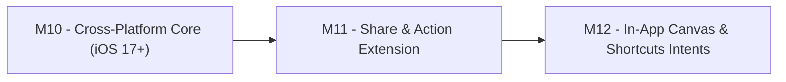

# 🗺️ DropLab — Roadmap & Phase 2 Plan

> **Trạng thái hiện tại:** 🎉 Đã hoàn thành toàn bộ lộ trình **Phase 1 (macOS v1.0.0)** và **Phase 2 (macOS v2.0.0: `M6`, `M7`, `M8`, `M9`)** với `9/9` unit tests pass 100%!
> **Kế hoạch tiếp theo:** **Phase 3 — DropLab iOS & iPadOS Companion (M10 ➔ M12)**.

---

## 0. Quyết định cốt lõi (Đã chốt)

| # | Hạng mục | Quyết định |
|---|---|---|
| D1 | Tên sản phẩm | **DropLab** (Swift package `DropLabCore`, CLI `droplab`, App `DropLab.app`) |
| D2 | Phân phối | **Developer ID + Notarization**, không sandbox trên macOS (để ghi file trực tiếp cạnh file gốc) |
| D3 | Codec bên thứ ba | **Đồng ý** đóng gói/liên kết LAME (`mp3`), libwebp (`webp`), FFmpeg LGPL (`ogg`, `flac`, `webm`), kèm license trong About |
| D4 | Nền tảng ưu tiên | **macOS là chính** (đã hoàn thành v2.0.0), **iPhone/iPad là companion phụ** (Phase 3) |
| D5 | Ưu tiên giao diện | **Vòng Xoay Trọng Lực (Radial Orbit — Concept 1)** là chủ lực, kết hợp **Lò Luyện Tai Thỏ (Notch Tray — Concept 2)** |

---

## 1. Phase 1 — Nền tảng macOS 1.0.0 (✅ Đã hoàn thành)

- [x] **Phase 0 — Technical Spikes:** Kiểm chứng `NSPasteboard(name: .drag)` 60 Hz, `NSPanel` non-activating + `NSDraggingDestination`, pipeline `AVAssetReader/Writer` & `ImageIO`.
- [x] **M1 — `DropLabCore` Engine + CLI `droplab`:**
  - Nhận diện `UTType`, `ConversionRegistry`, `SafeOutputNaming` (chống ghi đè), `ConversionHistory` (Undo 1 chạm).
  - Native Audio (`wav`, `caf`, `aiff`, `m4a` + `LEI16`, `24-bit`, `Mono`, `Trim 8s`), Image (`png`, `jpg`, `heic`, `tiff`, `icns`, `pdf`, `svg`), Video (`mp4`, `mov`, `Mute Audio`), Data (`json ⟷ plist`, `csv ⟷ tsv`).
- [x] **M2 — Radial Orbit MVP (Concept 1):**
  - Kéo & giữ yên chuột `0.4s` bung Vòng Xoay 2 tầng (Vòng trong: Định dạng đích, Vòng ngoài: Sub-Orbit Presets).
  - Thả chuột để convert ngay cạnh file gốc, Toast thông báo kèm nút mở Finder & Hoàn tác.
- [x] **M3 — Notch Tray + Inline Waveform Trimmer (Concept 2):**
  - Tự hiện viên thuốc đón file ở Notch khi bắt đầu kéo; thả file để mở khay điều khiển, cuộn Trackpad 2 ngón / phím `←` `→`, chỉnh 2 tay cầm vàng cắt Waveform & nghe thử (`Space`).
- [x] **M4 — Extended Codecs + Video/PDF Multi-tool:**
  - Tích hợp `mp3` (LAME), `webp` (`cwebp`), `ogg`, `flac`, `webm` (FFmpeg), `Video ➔ Animated GIF` (native `ImageIO`), gộp & tách trang PDF (`PDFKit`).
- [x] **M5 — Release 1.0 macOS Polish & File Access Fix:**
  - Đóng gói `DropLab.app` v1.0.0 kèm `AppIcon.icns`, `Launch at Login` (`SMAppService`), `About & Licenses`, mở khóa Security-Scoped / File-Reference URLs & bộ giải mã ảnh 4 tầng (`ImageIO` ➔ `CoreImage` ➔ `NSImage`).

---

## 2. Phase 2 — macOS Power Tools & On-Device AI v2.0.0 (✅ Đã hoàn thành)

### 🎯 M6 — Tinh chỉnh UX Vòng Xoay từ thực tế sử dụng + Haptics (v1.1 — ✅ Đã hoàn thành)
- [x] **Chống che khuất chữ Sub-Orbit bởi Thumbnail kéo của Finder:**
  - Hiển thị **Tên Định dạng + Preset đang chọn ngay tại Tâm Vòng Xoay (Center Hub)** và **Top Floating HUD Pill** ở đỉnh vòng xoay.
- [x] **Phản hồi xúc giác Trackpad (Haptic Feedback):**
  - Gọi `NSHapticFeedbackManager.defaultPerformer.perform(.alignment)` mỗi khi con trỏ lướt qua các lát cắt.
- [x] **Phím tắt toàn cục cấp hệ thống (Global Hotkey `⌥Space`):**
  - Đăng ký phím tắt toàn cục (`Carbon RegisterEventHotKey`) chọn file trong Finder bấm `⌥Space` bung Vòng Xoay ngay tại con trỏ.

### 🛠️ M7 — Công cụ Chuyên sâu cho Developer & Designer (v1.2 — ✅ Đã hoàn thành)
- [x] **Xcode `.appiconset` Generator:**
  - Kéo ảnh ➔ `ICNS -> .appiconset` ➔ sinh trọn bộ thư mục `AppIcon.appiconset` kèm `Contents.json` chuẩn Xcode.
- [x] **Nén PDF thông minh (`Compress PDF`):**
  - Nén dung lượng file PDF nặng (tái nén trang ảnh nhúng bằng Quartz / ImageIO).
- [x] **SVG / Image ➔ SwiftUI `Shape` Code (`SwiftShapeConverter`):**
  - Kéo file vector `.svg` hoặc ảnh ➔ chọn `SWIFT` ➔ sinh file `.swift` chứa `struct CustomShape: Shape` chuẩn tỉ lệ `[0, 1]` kèm `#Preview`.
- [x] **SpriteSheet Generator (`SpriteSheetGenerator`):**
  - Kéo nhiều ảnh frame `.png` ➔ chọn `PNG -> SpriteSheet` ➔ ghép thành 1 tấm `*_spritesheet.png` + file atlas metadata `*_spritesheet.json`.

### 🧠 M8 — On-Device Apple Silicon AI (v1.3 — 100% Offline & Miễn phí — ✅ Đã hoàn thành)
- [x] **Tách nền ảnh 1 chạm (`PNG -> Tách nền AI`):**
  - Dùng `VNGenerateForegroundInstanceMaskRequest` (`Vision` framework) tách nền chủ thể và xuất `.png` trong suốt ngay tại chỗ.
- [x] **OCR Trích xuất văn bản (`Image / PDF -> TXT`):**
  - Dùng `VNRecognizeTextRequest` tự động nhận diện chữ từ ảnh chụp hoặc PDF scan ra file `.txt`.
- [x] **Audio / Video ➔ Phụ đề `.srt` (`SpeechAIConverter`):**
  - Dùng `SFSpeechRecognizer` trên thiết bị (kèm bộ phân đoạn âm thanh dự phòng) để tạo file phụ đề SubRip `.srt`.

### 🏝️ M9 — Khay Kéo-Ra ở Tai Thỏ (Notch Output Shelf) & Tiện ích Mở rộng (v2.0 — ✅ Đã hoàn thành)
- [x] **Notch Output Drag-Out Shelf (`NotchTrayMode.outputShelf`):**
  - Sau khi chuyển đổi trong Tai Thỏ, khay giữ thẻ file kết quả để **kéo trực tiếp file mới từ Tai Thỏ thả thẳng vào Slack, Telegram, Browser, Xcode**, hoặc bấm `Copy File` / `Mở Finder`.
- [x] **Finder "Open With" & macOS System Services (`NSServices`):**
  - Chuột phải file trong Finder ➔ `Open With -> DropLab` hoặc menu `Services -> Mở bằng Vòng Xoay DropLab`.

---

## 3. Phase 3 — DropLab iOS & iPadOS Companion (M10 ➔ M12)

### 📱 M10 — Tương thích Đa nền tảng `DropLabCore` (iOS 17+ & macOS 14+)
- [ ] Trừu xuất `AppKit` (`NSImage`) thành abstraction dùng cả `UIKit` (`UIImage`) trên iOS và `AppKit` (`NSImage`) trên macOS thông qua `#if canImport(UIKit)`.
- [ ] Bổ sung `.iOS(.v17)` vào `platforms` trong `Package.swift`.
- [ ] Kiểm thử toàn bộ pipeline Image, Audio, Video, PDF, Data trên simulator iOS.

### 📤 M11 — iOS Share & Action Extension (`DropLab Converter`)
- [ ] Xây dựng **Action Extension** xuất hiện trong sheet Share hệ thống của iOS (trong app *Files/Tệp* và *Photos/Ảnh*).
- [ ] Giao diện Carousel / Radial thu gọn trên iOS giúp người dùng vuốt chọn nhanh định dạng (`PNG`, `WEBP`, `PDF`, `TXT`, `WAV`, `MP3`).
- [ ] Lưu file kết quả trực tiếp vào thư mục gốc trong Files hoặc trả về sheet chia sẻ.

### ⚡ M12 — Standalone iOS App, Shortcuts App Intents & Live Activity
- [ ] Ứng dụng iOS độc lập: Khu vực thả file cảm ứng, hỗ trợ Drag & Drop hai ngón hoặc Split View trên iPad.
- [ ] Tích hợp **App Intents** cho ứng dụng *Phím tắt (Shortcuts)* để người dùng tạo workflow tự động hoá chuyển đổi file.
- [ ] Hỗ trợ **ActivityKit (Live Activity)** hiển thị tiến trình khi chuyển đổi lô file trên Dynamic Island của iPhone.
